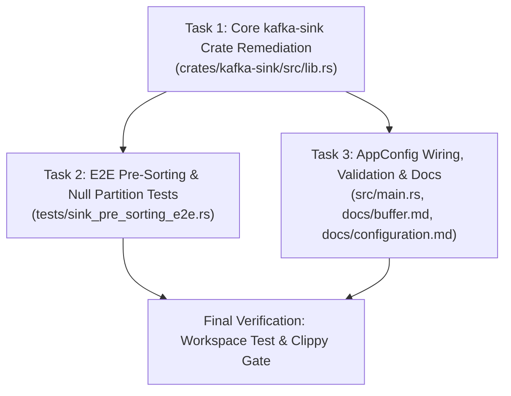

# Design Specification: Kafka Sink Producer Flush on Shutdown and Null Partition Key Safety

## 1. Context and Problem Statement

Apache Kafka sink integration in `opentelemetry-datalake` ([`crates/kafka-sink`](file:///Users/jlamb/go/src/github.com/jimmystewpot/opentelemetry-datalake/crates/kafka-sink)) streams Arrow `RecordBatch` payloads from logs, metrics, and traces pipelines to designated Kafka topics.

GitHub Issue [#130](https://github.com/jimmystewpot/opentelemetry-datalake/issues/130) identified two critical reliability defects in [`crates/kafka-sink/src/lib.rs`](file:///Users/jlamb/go/src/github.com/jimmystewpot/opentelemetry-datalake/crates/kafka-sink/src/lib.rs):
1. **Producer Flush Missing on Shutdown**: In [`KafkaSink::run`](file:///Users/jlamb/go/src/github.com/jimmystewpot/opentelemetry-datalake/crates/kafka-sink/src/lib.rs#L164-L207), when the input channel closes (`input.recv().await == None`), the sink exits immediately without calling `producer.flush()`. Any messages buffered in `librdkafka`'s internal C queues or socket buffers are dropped upon process termination, violating the pipeline at-least-once delivery contract specified in [`docs/buffer.md`](file:///Users/jlamb/go/src/github.com/jimmystewpot/opentelemetry-datalake/docs/buffer.md) and [`AGENTS.md`](file:///Users/jlamb/go/src/github.com/jimmystewpot/opentelemetry-datalake/AGENTS.md).
2. **Unchecked Arrow Null Array Access in Partition Slicing**: In [`extract_partition_slices`](file:///Users/jlamb/go/src/github.com/jimmystewpot/opentelemetry-datalake/crates/kafka-sink/src/lib.rs#L41-L79), `str_arr.value(0)` and `str_arr.value(i)` are invoked directly without checking `str_arr.is_null(i)`. This violates [`AGENTS.md`](file:///Users/jlamb/go/src/github.com/jimmystewpot/opentelemetry-datalake/AGENTS.md) Section 1 (*"Never call `.value(i)` on an Arrow array without first checking `.is_null(i)`"*). In Arrow `StringArray`, reading a null slot returns an empty string `""`. Consequently, `null` partition keys are erroneously conflated with `""` (`Some("")`), corrupting partition slicing. Furthermore, the existing return type `Vec<(String, RecordBatch)>` forces null keys to be published as 0-byte keys (`b""`) rather than unkeyed (`None`) records, breaking Kafka's partition distribution.

This document specifies the architectural remediation for both defects.

---

## 2. Architecture & Design Details

### 2.1 Arrow Null Guarding and Strongly-Typed Partition Keys

#### Signature Update
The function signature in [`crates/kafka-sink/src/lib.rs`](file:///Users/jlamb/go/src/github.com/jimmystewpot/opentelemetry-datalake/crates/kafka-sink/src/lib.rs#L41-L79) is updated to distinguish missing keys (`None`) from empty string keys (`Some("")`):

```rust
pub fn extract_partition_slices(
    batch: &arrow::record_batch::RecordBatch,
    key_column: &str,
) -> Result<Vec<(Option<String>, arrow::record_batch::RecordBatch)>, PipelineError>
```

#### Slicing Algorithm
1. Locate `key_column` in `batch` and downcast to `arrow::array::StringArray` via `.as_any().downcast_ref::<StringArray>()`. Propagate `PipelineError::Internal` if column is missing or not UTF-8.
2. If `num_rows == 0`, return `Ok(Vec::new())`.
3. Read row keys safely without heap allocations during scanning:
   ```rust
   let get_key = |i: usize| -> Option<&str> {
       if str_arr.is_null(i) {
           None
       } else {
           Some(str_arr.value(i))
       }
   };
   ```
4. Initialize `current_val = get_key(0)` and `start = 0`. Iterate `i in 1..num_rows` (note: no special-case branch is needed for `num_rows == 1` as `1..1` is empty and `batch.slice(0, 1)` is a zero-copy `Arc` slice):
   - Let `val = get_key(i)`.
   - If `val != current_val`:
     - Push `(current_val.map(str::to_owned), batch.slice(start, i - start))` to `slices`.
     - Update `start = i` and `current_val = val`.
   - After the loop, push the trailing slice `(current_val.map(str::to_owned), batch.slice(start, num_rows - start))`.
5. Zero heap string allocations occur inside the comparison loop; allocations only occur once per contiguous slice when pushing to the result vector.

#### Kafka Record Construction
In [`KafkaSink::run`](file:///Users/jlamb/go/src/github.com/jimmystewpot/opentelemetry-datalake/crates/kafka-sink/src/lib.rs#L164-L207):
* When `self.partition_key` is `None`: produce `vec![(None, sorted_batch)]`.
* When `self.partition_key` is `Some(ref p_key)`: invoke `extract_partition_slices(&sorted_batch, p_key)?`.
* For each `(key_opt, sub_batch)`:
  ```rust
  self.serialize_batch(&sub_batch, &mut buffer)?;
  let mut record = FutureRecord::to(&self.topic).payload(&buffer);
  if let Some(ref k) = key_opt {
      record = record.key(k.as_str());
  }
  ```
* When `key_opt` is `None`, `record.key` remains `None` (`FutureRecord<'_, str, Vec<u8>>`), allowing `librdkafka` to distribute unkeyed messages across all partitions via its configured partitioner (sticky/round-robin) rather than hashing `b""` to a single partition.

---

### 2.2 Sink Lifecycle and Graceful Producer Flush

#### Struct, Timeout Precedence, and Builder Additions
In [`crates/kafka-sink/src/lib.rs`](file:///Users/jlamb/go/src/github.com/jimmystewpot/opentelemetry-datalake/crates/kafka-sink/src/lib.rs#L32-L38):
1. Define constant `pub const DEFAULT_FLUSH_TIMEOUT_MS: u64 = 10_000;`.
2. Add `flush_timeout: std::time::Duration` to `KafkaSink`.
3. In `KafkaSink::try_new`, resolve the initial `flush_timeout` using strict precedence:
   - Check `options.get("delivery.timeout.ms")`, falling back to `options.get("message.timeout.ms")`.
   - Parse as `u64` and apply **only if `ms > 0`**. (In `librdkafka`, `0` denotes an infinite timeout; converting `0` to `Duration::from_millis(0)` would cause `producer.flush` to time out instantaneously without waiting for in-flight messages. When `0` or unparseable, fall back to `DEFAULT_FLUSH_TIMEOUT_MS`).
   - Otherwise, use `Duration::from_millis(DEFAULT_FLUSH_TIMEOUT_MS)` (10 seconds).
4. Provide builder method (which overrides the default or `options`-derived timeout):
   ```rust
   #[must_use]
   pub fn with_flush_timeout(mut self, timeout: std::time::Duration) -> Self {
       self.flush_timeout = timeout;
       self
   }
   ```

#### Graceful Shutdown Drain
In [`KafkaSink::run`](file:///Users/jlamb/go/src/github.com/jimmystewpot/opentelemetry-datalake/crates/kafka-sink/src/lib.rs#L164-L207):
* When `input.recv().await` yields `None`, upstream components have finished draining.
* Execute `Producer::flush` inside `tokio::task::spawn_blocking` to isolate synchronous C polling (`rd_kafka_flush`) from the Tokio async executor:
  ```rust
  let producer = self.producer.clone();
  let timeout = self.flush_timeout;
  tokio::task::spawn_blocking(move || {
      use rdkafka::producer::Producer;
      producer
          .flush(timeout)
          .map_err(|e| PipelineError::Storage(Box::new(e)))
  })
  .await
  .map_err(|e| PipelineError::Internal(format!("Kafka flush task panicked: {e}")))??;
  ```
* Return `Ok(())`.

#### Application Configuration and Validation Integration
In [`src/main.rs`](file:///Users/jlamb/go/src/github.com/jimmystewpot/opentelemetry-datalake/src/main.rs#L36-L53):
1. Add `#[serde(default)] flush_timeout_ms: Option<u64>` to `KafkaConfig`.
2. In [`validate_config`](file:///Users/jlamb/go/src/github.com/jimmystewpot/opentelemetry-datalake/src/main.rs#L140-L145), validate that `if kafka_cfg.flush_timeout_ms == Some(0)` an error is returned (`"Configuration validation failed: kafka.flush_timeout_ms must be greater than 0"`).
3. When initializing `logs_sink`, `traces_sink`, and `metrics_sink` in `src/main.rs`, apply `.with_flush_timeout( std::time::Duration::from_millis(ms))` when `kafka_cfg.flush_timeout_ms` is `Some(ms)`.
4. Update [`docs/buffer.md`](file:///Users/jlamb/go/src/github.com/jimmystewpot/opentelemetry-datalake/docs/buffer.md#L72) removing the gap item for issue #130.
5. Update [`docs/configuration.md`](file:///Users/jlamb/go/src/github.com/jimmystewpot/opentelemetry-datalake/docs/configuration.md#L70-L88) to document `flush_timeout_ms` under the `[kafka]` section.

---

## 3. Testing Strategy (Test-Driven Development)

All unit tests must be written first (RED), verified to fail, and then made to pass (GREEN).

### 3.1 Partition Key Slicing Tests (`crates/kafka-sink/src/lib.rs`)
1. `test_extract_partition_slices_with_null_keys`:
   - Schema with nullable `service_name` column (`DataType::Utf8, true`).
   - Rows: `[Some("svc-a"), None, Some("svc-b")]`.
   - Assert: 3 slices returned; keys are `Some("svc-a")`, `None`, and `Some("svc-b")`, each with 1 row.
2. `test_extract_partition_slices_all_nulls`:
   - Rows: `[None, None, None]`.
   - Assert: 1 slice returned; key is `None`, row count is 3.
3. `test_extract_partition_slices_distinct_empty_and_null`:
   - Rows: `[None, Some(""), None]`.
   - Assert: 3 slices returned; keys are `None` (1 row), `Some("")` (1 row), and `None` (1 row).
4. `test_extract_partition_slices_single_null`:
   - Rows: `[None]`.
   - Assert: 1 slice returned; key is `None`, row count is 1.
5. `test_extract_partition_slices_consecutive_identical_keys`:
   - Rows: `[Some("auth"), Some("auth"), None, None]`.
   - Assert: 2 slices returned; `Some("auth")` (2 rows) and `None` (2 rows).

### 3.2 End-to-End Sorting & Slicing (`tests/sink_pre_sorting_e2e.rs`)
- Update existing test assertions in `test_kafka_partition_extraction_edge_cases` and `test_e2e_kafka_sink_presorting` to inspect `Option<String>` (`slice.0.as_deref() == Some(...)`).
- Add test case verifying that a batch with null, empty-string, and non-empty partition keys pre-sorted with `BatchSorter` places nulls last (`nulls_last = true`) and slices cleanly into distinct `Some(...)` and `None` groups.

### 3.3 Producer Flush Configuration & Deterministic Lifecycle Tests (`crates/kafka-sink/src/lib.rs`)
Because `FutureProducer::send(...).await` waits on broker acknowledgement up to `message.timeout.ms` (default 300s), unit tests must not call `FutureProducer::send().await` against a non-existent broker. Instead, we test the shutdown flush deterministically in <100ms via two tests:
1. `test_kafka_sink_flush_timeout_resolution`:
   - Verify default `flush_timeout` is 10s.
   - Verify `options` with `"message.timeout.ms" = "3000"` sets `flush_timeout` to 3s.
   - Verify `"delivery.timeout.ms"` takes precedence over `"message.timeout.ms"`.
   - Verify `"message.timeout.ms" = "0"` falls back to 10s (preventing 0ms instant timeout).
   - Verify `.with_flush_timeout(Duration::from_millis(250))` overrides all defaults.
2. `test_kafka_sink_run_flushes_on_channel_close`:
   - **Case A (Clean empty queue drain)**: Send a 0-row batch (or drop `tx` immediately) and verify `sink.run(rx).await` completes `Ok(())` via `spawn_blocking` flush.
   - **Case B (In-flight C queue flush failure propagation)**: Enqueue a record into `librdkafka`'s internal C buffer using synchronous `sink.producer.send_result(FutureRecord::to("test-topic").payload("data").key("k"))` against an unreachable broker (`127.0.0.1:1`), configure `with_flush_timeout(Duration::from_millis(50))`, drop `tx`, and await `sink.run(rx).await`. Because the message remains trapped in `librdkafka`'s C queue past the 50ms flush deadline, `producer.flush` must fail with `OperationTimedOut` and `sink.run` must return `Err(PipelineError::Storage(_))`. This proves `producer.flush` is genuinely executed on channel EOF and its errors are propagated.

---

## 4. Optimized Task Decomposition & Subagent Execution Strategy

### Avoiding File Contention
Putting two parallel subagents on [`crates/kafka-sink/src/lib.rs`](file:///Users/jlamb/go/src/github.com/jimmystewpot/opentelemetry-datalake/crates/kafka-sink/src/lib.rs) simultaneously would cause write conflicts in `KafkaSink::run` and `mod tests`, Cargo build lock contention, or 3-way git merge conflicts.

Instead, the work is structured as a **2-stage DAG** where every task owns strictly disjoint files:



1. **Task 1 (`crates/kafka-sink/src/lib.rs`)**: Implements both the null-safe `extract_partition_slices` (`Option<String>`) and the `flush_timeout` + `spawn_blocking` `producer.flush()` in `KafkaSink`, along with all `kafka-sink` unit tests.
2. **Task 2 (`tests/sink_pre_sorting_e2e.rs`) & Task 3 (`src/main.rs`, `docs/buffer.md`, `docs/configuration.md`)**: Touch completely disjoint files and depend only on Task 1's public API (`extract_partition_slices` and `KafkaSink::with_flush_timeout`). They can execute sequentially via `subagent-driven-development` or in parallel without any file overlap.

---

## 5. Verification Checklist

- [ ] All unit tests pass via `cargo test -p kafka-sink`.
- [ ] Integration tests pass via `cargo test --test sink_pre_sorting_e2e`.
- [ ] Binary configuration validation tests pass via `cargo test --bin opentelemetry-datalake`.
- [ ] No compilation warnings or clippy warnings across workspace: `cargo clippy --workspace --all-targets -- -D warnings`.
- [ ] Zero unchecked `.value(i)` calls remain in `extract_partition_slices`.
- [ ] Producer queue is flushed within `spawn_blocking` before `KafkaSink::run` exits.
