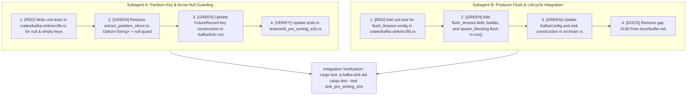

# Design Specification: Kafka Sink Producer Flush on Shutdown and Null Partition Key Safety

## 1. Context and Problem Statement

Apache Kafka sink integration in `opentelemetry-datalake` ([`crates/kafka-sink`](file:///Users/jlamb/go/src/github.com/jimmystewpot/opentelemetry-datalake/crates/kafka-sink)) streams Arrow `RecordBatch` payloads from logs, metrics, and traces pipelines to designated Kafka topics.

GitHub Issue [#130](https://github.com/jimmystewpot/opentelemetry-datalake/issues/130) identified two critical reliability defects in [`crates/kafka-sink/src/lib.rs`](file:///Users/jlamb/go/src/github.com/jimmystewpot/opentelemetry-datalake/crates/kafka-sink/src/lib.rs):
1. **Producer Flush Missing on Shutdown**: In [`KafkaSink::run`](file:///Users/jlamb/go/src/github.com/jimmystewpot/opentelemetry-datalake/crates/kafka-sink/src/lib.rs#L164-L207), when the input channel closes (`input.recv().await == None`), the sink exits immediately without calling `producer.flush()`. Any messages buffered in `librdkafka`'s internal C queues or socket buffers are dropped upon process termination, violating the pipeline at-least-once delivery contract specified in [`docs/buffer.md`](file:///Users/jlamb/go/src/github.com/jimmystewpot/opentelemetry-datalake/docs/buffer.md) and [`AGENTS.md`](file:///Users/jlamb/go/src/github.com/jimmystewpot/opentelemetry-datalake/AGENTS.md).
2. **Unchecked Arrow Null Array Access in Partition Slicing**: In [`extract_partition_slices`](file:///Users/jlamb/go/src/github.com/jimmystewpot/opentelemetry-datalake/crates/kafka-sink/src/lib.rs#L41-L79), `str_arr.value(0)` and `str_arr.value(i)` are invoked directly without checking `str_arr.is_null(i)`. This violates [`AGENTS.md`](file:///Users/jlamb/go/src/github.com/jimmystewpot/opentelemetry-datalake/AGENTS.md) Section 1 (*"Never call `.value(i)` on an Arrow array without first checking `.is_null(i)`"*). In Arrow `StringArray`, reading a null slot returns an empty string `""`. Consequently, `null` partition keys are erroneously conflated with `""` (`Some("")`), corrupting partition slicing. Furthermore, the existing return type `Vec<(String, RecordBatch)>` forces null keys to be published as 0-byte keys (`b""`) rather than unkeyed (`None`) records, breaking Kafka's partition distribution.

This document specifies the architectural remediation for both defects.

---

## 2. Architecture & Design Details

### 2.1 Arrow Null Guarding and Strongly-Typed Partition Keys

#### Signature Update
The function signature in [`crates/kafka-sink/src/lib.rs`](file:///Users/jlamb/go/src/github.com/jimmystewpot/opentelemetry-datalake/crates/kafka-sink/src/lib.rs#L41-L79) is updated to distinguish missing keys from empty keys:

```rust
pub fn extract_partition_slices(
    batch: &arrow::record_batch::RecordBatch,
    key_column: &str,
) -> Result<Vec<(Option<String>, arrow::record_batch::RecordBatch)>, PipelineError>
```

#### Slicing Algorithm
1. Locate `key_column` in `batch` and downcast to `arrow::array::StringArray` via `.as_any().downcast_ref::<StringArray>()`. Propagate `PipelineError::Internal` if column is missing or not UTF-8.
2. If `num_rows == 0`, return `Ok(Vec::new())`.
3. Read row keys safely without unnecessary heap allocations during scanning:
   ```rust
   let get_key = |i: usize| -> Option<&str> {
       if str_arr.is_null(i) {
           None
       } else {
           Some(str_arr.value(i))
       }
   };
   ```
4. If `num_rows == 1`, return `vec![(get_key(0).map(ToString::to_string), batch.clone())]`.
5. For `num_rows > 1`, initialize `current_val = get_key(0)` and `start = 0`. Iterate `i in 1..num_rows`:
   - If `get_key(i) != current_val`:
     - Push `(current_val.map(ToString::to_string), batch.slice(start, i - start))` to `slices`.
     - Update `start = i` and `current_val = get_key(i)`.
   - After the loop, push the trailing slice `(current_val.map(ToString::to_string), batch.slice(start, num_rows - start))`.
6. Zero heap string allocations occur inside the iteration loop; allocations only occur once per contiguous slice when pushing to the result vector.

#### Kafka Record Construction
In [`KafkaSink::run`](file:///Users/jlamb/go/src/github.com/jimmystewpot/opentelemetry-datalake/crates/kafka-sink/src/lib.rs#L164-L207):
* When `self.partition_key` is `None`: produce `vec![(None, sorted_batch)]`.
* When `self.partition_key` is `Some(key)`: invoke `extract_partition_slices(&sorted_batch, key)?`.
* For each `(key_opt, sub_batch)`:
  ```rust
  self.serialize_batch(&sub_batch, &mut buffer)?;
  let mut record = FutureRecord::to(&self.topic).payload(&buffer);
  if let Some(ref k) = key_opt {
      record = record.key(k.as_str());
  }
  ```
* When `key_opt` is `None`, the record is unkeyed, allowing Kafka to distribute messages across all partitions via the sticky/round-robin partitioner.

---

### 2.2 Sink Lifecycle and Graceful Producer Flush

#### Struct and Builder Additions
In [`crates/kafka-sink/src/lib.rs`](file:///Users/jlamb/go/src/github.com/jimmystewpot/opentelemetry-datalake/crates/kafka-sink/src/lib.rs#L32-L38):
1. Add `flush_timeout: std::time::Duration` to `KafkaSink`.
2. In `KafkaSink::try_new`:
   - Initialize `flush_timeout` with a 10-second default (`Duration::from_secs(10)`).
   - If `options` contains `"message.timeout.ms"` or `"delivery.timeout.ms"`, parse that value into `flush_timeout` if valid.
3. Provide builder method:
   ```rust
   #[must_use]
   pub fn with_flush_timeout(mut self, timeout: std::time::Duration) -> Self {
       self.flush_timeout = timeout;
       self
   }
   ```

#### Graceful Shutdown Drain
In [`KafkaSink::run`](file:///Users/jlamb/go/src/github.com/jimmystewpot/opentelemetry-datalake/crates/kafka-sink/src/lib.rs#L164-L207):
* When `input.recv().await` yields `None`, upstream components have finished draining.
* Execute `Producer::flush` inside `tokio::task::spawn_blocking` to avoid blocking Tokio's runtime:
  ```rust
  let producer = self.producer.clone();
  let timeout = self.flush_timeout;
  tokio::task::spawn_blocking(move || {
      use rdkafka::producer::Producer;
      producer.flush(timeout)
          .map_err(|e| PipelineError::Storage(Box::new(e)))
  })
  .await
  .map_err(|e| PipelineError::Internal(format!("Kafka flush join error: {e}")))??;
  ```
* Return `Ok(())`.

#### Application Configuration Integration
In [`src/main.rs`](file:///Users/jlamb/go/src/github.com/jimmystewpot/opentelemetry-datalake/src/main.rs#L36-L53):
1. Add `flush_timeout_ms: Option<u64>` to `KafkaConfig`.
2. When creating `logs_sink`, `traces_sink`, and `metrics_sink`, call `.with_flush_timeout(Duration::from_millis(timeout))` if `flush_timeout_ms` is configured.
3. Update [`docs/buffer.md`](file:///Users/jlamb/go/src/github.com/jimmystewpot/opentelemetry-datalake/docs/buffer.md#L72) removing the gap item for issue #130.

---

## 3. Testing Strategy (Test-Driven Development)

All unit tests must be written first (RED), verified to fail, and then made to pass (GREEN).

### 3.1 Partition Key Slicing Tests (`crates/kafka-sink/src/lib.rs`)
1. `test_extract_partition_slices_with_null_keys`:
   - Schema with nullable `service_name` column.
   - Rows: `[Some("svc-a"), None, Some("svc-b")]`.
   - Assert: 3 slices returned; keys are `Some("svc-a")`, `None`, and `Some("svc-b")`.
2. `test_extract_partition_slices_all_nulls`:
   - Rows: `[None, None, None]`.
   - Assert: 1 slice returned; key is `None`, row count is 3.
3. `test_extract_partition_slices_distinct_empty_and_null`:
   - Rows: `[None, Some(""), None]`.
   - Assert: 3 slices returned; keys are `None` (1 row), `Some("")` (1 row), and `None` (1 row).
4. `test_extract_partition_slices_single_null`:
   - Rows: `[None]`.
   - Assert: 1 slice returned; key is `None`, row count is 1.
5. `test_extract_partition_slices_consecutive_identical_keys`:
   - Rows: `[Some("auth"), Some("auth"), None, None]`.
   - Assert: 2 slices returned; `Some("auth")` (2 rows) and `None` (2 rows).

### 3.2 End-to-End Sorting & Slicing (`tests/sink_pre_sorting_e2e.rs`)
- Update existing test assertions in `test_kafka_partition_extraction_edge_cases` and `test_e2e_kafka_sink_presorting` to inspect `Option<String>` (`slice.0.as_deref() == Some(...)`).
- Add test case verifying that a batch with null partition keys pre-sorted with `BatchSorter` slices correctly into `None` groups.

### 3.3 Producer Flush Configuration & Lifecycle Tests (`crates/kafka-sink/src/lib.rs`)
1. `test_kafka_sink_flush_timeout_builder`:
   - Verify default timeout is 10 seconds.
   - Verify `with_flush_timeout(Duration::from_millis(500))` overrides it.
   - Verify parsing from `options.get("message.timeout.ms")`.
2. `test_kafka_sink_shutdown_flush`:
   - Test channel drain and shutdown invocation where sender is dropped after writing a batch.

---

## 4. Parallel Subagent Task Decomposition

The implementation tasks have cleanly separated file boundaries and responsibilities, enabling parallel execution via subagents:



### Subagent A Work Scope
* **Files**: [`crates/kafka-sink/src/lib.rs`](file:///Users/jlamb/go/src/github.com/jimmystewpot/opentelemetry-datalake/crates/kafka-sink/src/lib.rs), [`tests/sink_pre_sorting_e2e.rs`](file:///Users/jlamb/go/src/github.com/jimmystewpot/opentelemetry-datalake/tests/sink_pre_sorting_e2e.rs).
* **Responsibilities**:
  1. Add unit tests for null and empty string partition slicing.
  2. Implement safe null checks in `extract_partition_slices` and update return type to `Vec<(Option<String>, RecordBatch)>`.
  3. Update `KafkaSink::run` key assignment logic.
  4. Update `tests/sink_pre_sorting_e2e.rs` callers and assertions.

### Subagent B Work Scope
* **Files**: [`crates/kafka-sink/src/lib.rs`](file:///Users/jlamb/go/src/github.com/jimmystewpot/opentelemetry-datalake/crates/kafka-sink/src/lib.rs), [`src/main.rs`](file:///Users/jlamb/go/src/github.com/jimmystewpot/opentelemetry-datalake/src/main.rs), [`docs/buffer.md`](file:///Users/jlamb/go/src/github.com/jimmystewpot/opentelemetry-datalake/docs/buffer.md).
* **Responsibilities**:
  1. Add unit tests for `flush_timeout` builder and options parsing.
  2. Add `flush_timeout` field, builder method, and `spawn_blocking` `producer.flush()` invocation in `KafkaSink::run`.
  3. Add `flush_timeout_ms` to `KafkaConfig` in `src/main.rs` and apply `.with_flush_timeout(...)` during sink creation.
  4. Update `docs/buffer.md` to remove the #130 gap item.

---

## 5. Verification Checklist

- [ ] All new and modified tests pass via `cargo test -p kafka-sink`.
- [ ] Integration tests pass via `cargo test --test sink_pre_sorting_e2e`.
- [ ] No compilation warnings or clippy warnings across workspace: `cargo clippy --workspace --all-targets -- -D warnings`.
- [ ] Zero unchecked `.value(i)` calls remain in `extract_partition_slices`.
- [ ] Producer queue is flushed within `spawn_blocking` before `KafkaSink::run` exits.
